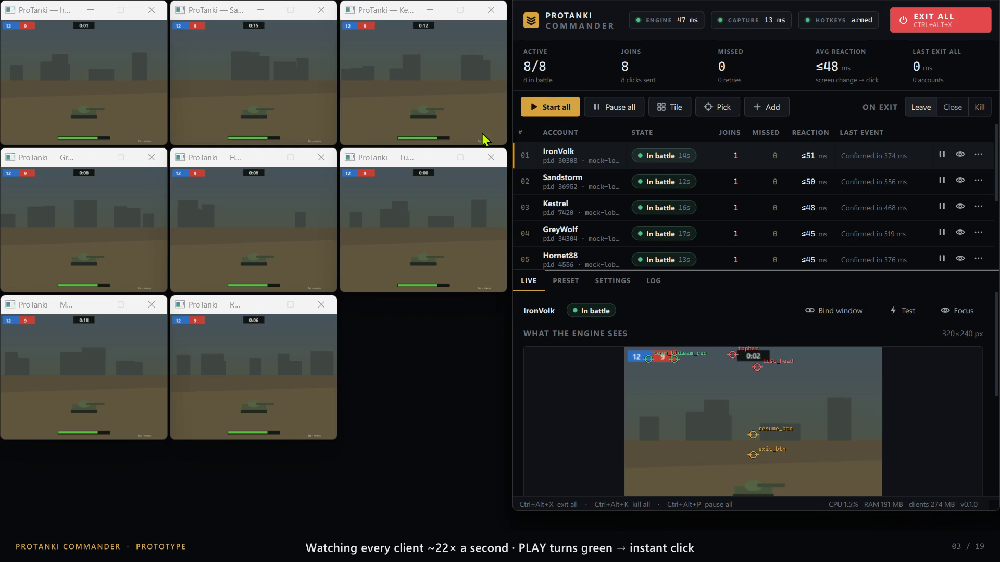
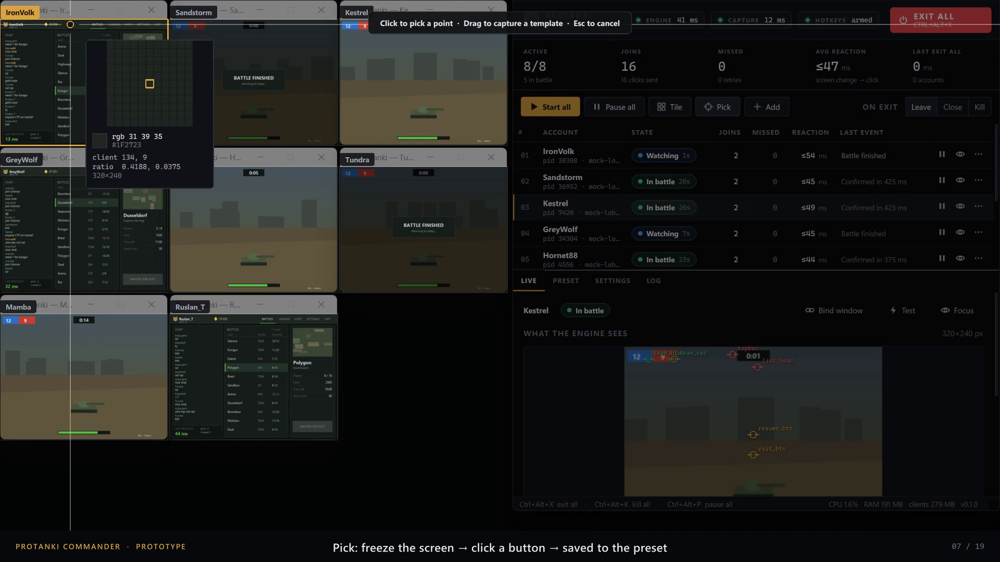
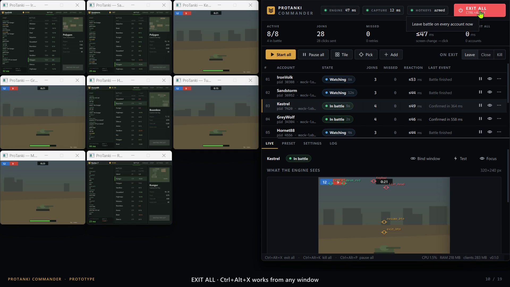

# ProTanki Commander

ProTanki Commander runs 6–10 ProTanki accounts from one lightweight Windows app:

- It watches every game window and clicks **Play** as soon as a battle opens.
- It checks that every click actually landed.
- It pulls **every account out at once** from a hotkey, a red button, or Telegram.



**[▶ Watch the 4-minute demo](docs/media/demo.mp4)**

The clients in the video are the bundled mock client, which behaves like the game lobby.

| Coordinate picker | Exit All from any window |
|---|---|
|  |  |

The full research and architecture write-up is in [`docs/index.html`](docs/index.html).

---

## What it does

| | |
|---|---|
| **Joins instantly** | Scans every client 25× per second and clicks as soon as the trigger appears. Reaction is about 40–90 ms from the screen changing to the click. |
| **Never misses silently** | After every click it checks that the screen moved on. If not, it retries; if the game ignores background clicks, it switches that account to real mouse input. Every miss is counted and logged. |
| **Exit All** | Ctrl+Alt+X (works system-wide), the red button, or Telegram `/exitall`. Three modes: leave battle, close client, kill. 8 accounts out in about 200 ms. |
| **Presets, not hard-coded clicks** | Positions and colours live in JSON presets. **Pick** freezes the screen, shows a magnifier, and saves a point or a template image in one click. |
| **Background, parallel clicks** | Clicks are sent straight to each window (`PostMessage`). The cursor doesn't move, no focus is needed, and all accounts are clicked at the same time. |
| **Light on the VPS** | One process with one screen grab per tick. Measured with 8 accounts: about 20 % of one CPU core with the UI open (about 11 % minimised) and about 180 MB RAM. The game clients themselves use far more. |
| **Self-healing** | Relaunches crashed clients, re-tiles windows, restores minimised ones, raises covered ones, and warns when the RDP desktop stops rendering. |

## Quick start (from source)

```powershell
py -3.12 -m venv .venv
.venv\Scripts\pip install -r requirements.txt
.venv\Scripts\python run.py --autostart      # 8 mock clients + the Commander
```

To build the client deliverable (a folder plus a zip that runs on a fresh VPS with no Python), run:

```powershell
powershell -ExecutionPolicy Bypass -File build.ps1
```

## The mock client

`mock/mock_protanki.py` is a stand-in game window used for testing and demos. It is a real Win32 window drawn like the ProTanki lobby:

- the battle list, battle info and **PLAY** button
- the loading screen, battle HUD and Esc menu

Slots open at random times and close after 2.5 s. The mock measures the **true reaction time**, from green appearing on screen to the click arriving, and counts any slot that was missed.

Options:

- `--strict-input` makes the mock ignore background clicks, the way some game engines do. Use it to demo the automatic fallback to real input.
- `--wait 4,16`, `--slot 2.5` and `--battle 12,30` tune the timing.

## Demo video + voice-over

1. Record the demo: `.venv\Scripts\python run.py --demo` (hands off for ~4.5 min), then `tools\make_demo_video.py recordings\<folder>`.
2. Narrate it: double-click **Record Voiceover.bat**. The studio plays the video, shows a teleprompter with the line to say now (word by word) and the next line, and records your mic in sync. Click **Merge into video** to get `demo_final.mp4`.

## How it works

```
UI thread (Qt)  ─┐
Hotkey thread   ─┼─► command queue ─► Engine thread, every 40 ms:
Telegram thread ─┘                     1 one screen grab covering all clients
                                       2 slice each client's region → pixel / template triggers
                                       3 per-account state machine
                                       4 actions → per-account worker → PostMessage / SendInput
                                       5 watchdog (crash, lost window, minimised, covered, black desktop)
```

Account states: `LAUNCHING → CONNECTING → WATCHING → JOINING → IN_BATTLE → WATCHING …`. `EXIT ALL` moves every account to `EXITING → EXITED` (or `CLOSING`) from any state.

## Project layout

```
commander/            the application
  engine.py           tick loop, commands, exit-all, watchdog, snapshots for the UI
  account.py          per-account state machine + action worker
  triggers.py         pixel / template triggers, compiled per client size
  config.py           typed settings / accounts / presets (JSON, validated)
  win32/              windows (bind, tile, coords), inputs (PostMessage, SendInput),
                      capture (screen grab, PrintWindow), hotkeys (RegisterHotKey)
  remote/telegram.py  optional /exitall /status /screenshot
  ui/                 Qt UI: main window, accounts table, inspector, picker, dialogs, theme
mock/                 ProTanki mock client
config/               settings.json, accounts.json, presets/*.json, templates/*.png
tools/                headless_run, dump_windows, spike_input, spike_capture, clone_install
vps/                  RDP fixes for running on a VPS
docs/index.html       research + architecture
```
